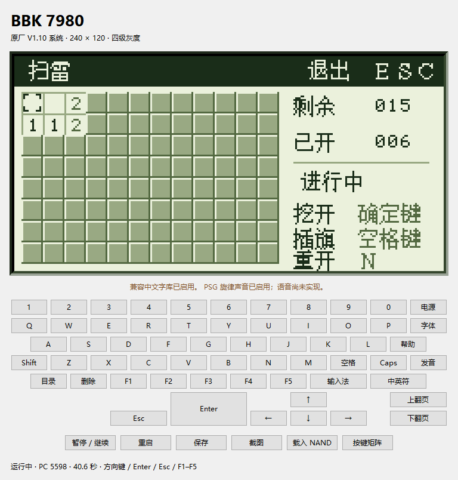

# 步步高 7980 模拟器（macOS 版）

在 macOS 上运行朗文 7980 的 V1.10 原厂系统。模拟器包含 65C02 指令、存储分页、128 KiB 外置 SRAM、定时器、中断、240 × 120 四级灰度 LCD、按键矩阵、UART 和虚拟 NAND。面板按 7980 真机照片排布，四方向键已在原厂工具菜单中逐一核对。

本仓库是 [HelloClyde/BBK7980-emulator](https://github.com/HelloClyde/BBK7980-emulator) 的 macOS 移植版：C 核心编译为 `bbk7980.dylib`，声音改用 CoreAudio（AudioQueue）输出，界面和打包流程只面向 macOS。



## 安装与运行

构建产物是一个可直接双击的 `dist/BBK7980.app`：

1. 将 `BBK7980.app` 拖进「应用程序」。
2. 双击启动。系统镜像已内嵌在 app 内，不需要另外下载 `runtime`。
3. 应用没有做 Developer ID 签名或公证；如果从网络传输后首次打开被 Gatekeeper 拦截，
   请在 Finder 中右键 `BBK7980.app` →「打开」，或执行：

   ```sh
   xattr -dr com.apple.quarantine /Applications/BBK7980.app
   ```

要求 macOS 11 或更高版本。构建产物使用打包机器的架构：在 Apple Silicon 上生成 arm64 应用，在 Intel Mac 上生成 x86_64 应用；Intel Mac 需在本机运行 `./build.sh`。

### 存档放在哪里

App Bundle 按只读处理，固件首次启动时会从 app 内复制到：

```text
~/Library/Application Support/BBK7980/runtime/
├── syscode.bin
├── installed-nand.bin.z
├── installed-manifest.json
└── data/
    └── nand.bin          # 点「保存」或正常退出时写入
```

升级或替换 `BBK7980.app` 不会丢失这个目录。想恢复出厂系统，退出模拟器后删除
`~/Library/Application Support/BBK7980/runtime/data/nand.bin` 即可。

## 键盘

在主界面按 Page Up / Page Down 翻页，按应用图标旁的数字打开应用。也可以用方向键选择、Enter 确认、Esc 返回。进入「娱乐」可打开《扫雷》，用方向键移动、Enter 翻开格子、空格插旗、Esc 退出。

| 电脑按键 | 模拟器按键 |
| --- | --- |
| 方向键、Enter、Esc | 四方向、确认、退出 |
| Fn + ↑ / Fn + ↓（或 Page Up / Page Down） | 上翻页 / 下翻页 |
| Fn + ←（或 Home） | 目录 |
| Backspace / Fn + Delete | 删除 |
| F1–F5 / F6 | F1–F5 / 帮助 |
| Caps Lock / Shift | 大小写 / Shift |

数字、字母、空格可直接输入；点面板上的电源、字体、帮助、输入法、中英符等按钮也可以操作。

macOS 菜单快捷键：

| 快捷键 | 操作 |
| --- | --- |
| ⌘S | 保存 NAND |
| ⇧⌘S | 截图 |
| ⌘P | 暂停 / 继续 |
| ⌘R | 重启 |
| ⌘W | 保存并关闭 |
| ⌘Q | 保存并退出 |

Command 和 Option 组合键留给 macOS 菜单与输入法，不会发送到 7980。菜单中的「载入 NAND」可打开同一模拟器格式的 NAND 文件。

## 单个文件的导入和导出

- 点「导入文件」，在文件选择器里选中一个或多个普通数据文件或 7980 SDK 生成的 `BJBBK.110` 应用传输包。普通数据文件沿用文件名，应用沿用包内的文件名和分类。所有文件读回校验通过后统一保存，同名机内文件会被替换。
- 点「导出文件」，点击选中列表中的一个或多个机内文件，再选择 Mac 上的保存目录。文件按原名保存，遇到同名文件会先确认。导出的是机内文件原始内容，应用的 PC 传输包头需要使用 SDK 另行生成。
- 两项操作都通过原厂「电脑联机」，会重启模拟器。请先在当前应用里保存进度。

## 从源码运行

需要：

- macOS 11+ 和 Xcode Command Line Tools（`xcode-select --install`，提供 `clang`）
- Python 3.11+，且带 `tkinter`（python.org 安装包或 Homebrew `python-tk`）
- Pillow

```sh
python3 -m venv .venv
source .venv/bin/activate
python -m pip install -r requirements.txt -r requirements-build.txt
python build.py
python app.py
```

仓库根目录的 `runtime/` 供源码运行使用。如果没有该目录，可解压
`BBK7980-V1.10-runtime.zip`：

```sh
unzip BBK7980-V1.10-runtime.zip
```

也可以在首次启动时选择[步步高官网 7980 V1.10 升级包](https://down.eebbk.net/xzzx/7980/1/7980sj.exe)，
由模拟器在 `~/Library/Application Support/BBK7980/runtime` 现场生成运行镜像。官网升级包的
SHA-256 为 `b9c4aa62cd9517859930620cdce5f7c6027120777926bb49e56989bb4e8d145c`。

用官网包手工生成镜像：

```sh
python prepare.py ~/Downloads/7980sj.exe --runtime "$PWD/runtime-new"
python app.py --runtime "$PWD/runtime-new"
```

## 打包

```sh
./build.sh
open dist/BBK7980.app
```

`build.sh` 会依次编译 `bbk7980.dylib`、收集 `runtime/`、调用 PyInstaller 生成
`dist/BBK7980.app`，并写入 Info.plist、图标、文档和第三方许可。不会生成 DMG、压缩包，
也不会做 Developer ID 签名或公证；PyInstaller 为满足 Apple Silicon 的运行要求会自动写入
ad-hoc 签名。打包时会排除 `runtime/data/`，不会把本机存档带进 app。

如果 Python 不在 `.venv/` 中，可以指定解释器：

```sh
PYTHON=/path/to/python3 ./build.sh
```

## 测试

```sh
python -m unittest discover -s tests -v
```

未准备官网升级包时，测试使用合成 ROM 检查 CPU、中断及 NAND；原厂系统的集成测试会跳过。
准备完整的 `runtime/`（含 `initialized-nand.bin.z` 和 `font.bin`）后会自动运行系统级测试。

## 实现说明

- `src/machine.c`：65C02/ST2xxx 板级模型，与上游一致。
- `src/audio_macos.c`：CoreAudio AudioQueue 输出，22050 Hz 单声道 16 位 PCM；实时回调在 C 层完成，不进入 Python。
- `machine.py`：从 App Bundle 的 `Frameworks` 目录加载 `bbk7980.dylib`；把可写运行目录固定到 Application Support。
- `app.py`：Tk/aqua 界面、macOS 菜单与快捷键、中文字体；Power 键休眠时显示黑屏的行为保持不变。

## 已知限制和许可

兼容字库基于 GNU Unifont，字形与原厂字库有差别。PSG 方波旋律可输出，原机语音尚未实现，中文输入法仍有兼容问题。RAM 和部分外设的参数是模拟模型，真机容量和完整电气时序仍待确认。更多实现细节见[硬件研究](hardware.md)。

模拟器采用 [GPL-3.0](COPYING)。感谢 9288 / GAM4980 和 Unifont 的贡献者，见[第三方组件与致谢](THIRD_PARTY.md)。
